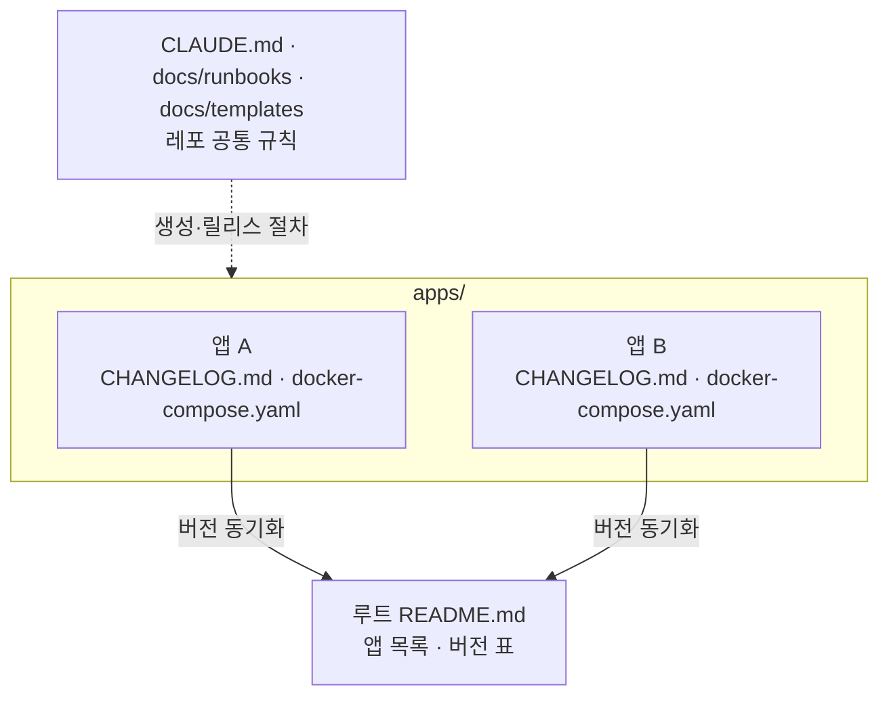

# 아키텍처

## 개요
이 레포는 서로 독립된 소형 애플리케이션들의 모음이다. 각 앱은 `apps/<앱이름>/`에 들어 있으며,
자체 소스·컨테이너 정의·문서·버전을 가진다. 루트는 앱 목록(README)과 레포 공통 규칙(CLAUDE.md,
런북, 템플릿)만 갖고, 실행되는 코드는 두지 않는다. 앱은 `create-claude-app` 프리셋으로 만들고,
각자의 `docker compose up`으로 실행한다.

## 구조도

앱 A와 앱 B 사이에는 코드 의존이 없다.

## 컴포넌트
- **루트 README** — 사람용 앱 목록과 현재 버전·상태·주소 표 — `README.md`
- **레포 규칙** — Claude용 규칙과 디렉토리 지도 — `CLAUDE.md`
- **런북** — 앱 추가, 버전 릴리스 절차 — `docs/runbooks/`
- **템플릿** — 새 앱에 복사할 `CHANGELOG.md` — `docs/templates/app/`
- **앱** — 독립 프로젝트 하나. 내부 구조는 그 앱의 `ARCHITECTURE.md`가 소유 — `apps/<앱이름>/`

## 앱 하나의 표준 구성
`create-claude-app`이 생성하는 파일에 이 레포 규칙으로 `CHANGELOG.md`를 더한다.
```
apps/<앱이름>/
  README.md            사람용 앱 안내 (create-claude-app 생성)
  CLAUDE.md            앱 작업 규칙·명령어 (create-claude-app 생성)
  ARCHITECTURE.md      앱 내부 구조 (create-claude-app 생성)
  CHANGELOG.md         버전·패치노트 — 버전의 기준 문서 (이 레포 규칙)
  docker-compose.yaml  실행 정의
  docs/runbooks/       앱 단위 반복 작업
  <프리셋 구조>        frontend/ + backend/ 또는 src/
```

## 버전 흐름
1. 앱 코드를 바꾸면 같은 커밋에서 `CHANGELOG.md`의 `[Unreleased]`에 항목을 적는다.
2. 릴리스할 때 `[Unreleased]` 내용을 `[x.y.z] - YYYY-MM-DD` 섹션으로 옮기고,
3. 같은 커밋에서 앱 매니페스트의 버전 필드와 루트 `README.md` 표를 맞춘 뒤,
4. 릴리스 PR이 `main`에 머지되면 `main`에서 `<앱이름>/vx.y.z` 태그를 붙인다.

## 포트 배정
여러 앱을 동시에 띄워도 충돌하지 않도록 앱마다 **호스트 포트 하나**를 배정한다.
- 추가 순서대로 `3010`, `3020`, `3030`, … (이미 배정된 가장 큰 포트 + 10)
- 사용자가 브라우저로 여는 포트 하나만 호스트에 노출한다. DB·백엔드 내부 포트는 노출하지 않는다.
  (API·백엔드 프리셋처럼 백엔드를 직접 여는 앱은 그 포트가 배정 포트가 된다.)
- 화면도 API도 노출하지 않는 앱(데이터 수집·처리)은 포트를 배정하지 않는다.
- 배정 내역은 루트 `README.md` 앱 목록 표의 **주소** 칸이 기준이다.

## 외부 의존 · 인프라
- Docker / Docker Compose — 모든 앱의 유일한 실행 경로
- 그 밖의 외부 의존(DB, Claude API 등)은 앱별 `ARCHITECTURE.md`에 적는다.

## 주요 결정 · 제약
- **앱끼리 코드를 공유하지 않는다.** (사용자 결정) 자잘한 앱들이 서로 묶이면 하나를 고칠 때 다른 앱이 깨지고,
  앱 하나만 지우거나 보관하기 어려워진다. 중복은 감수한다.
- **앱별 독립 버전(SemVer).** 앱마다 수명과 변경 속도가 달라 레포 단일 버전으로는 의미가 없다.
  태그에 앱 이름 접두어(`<앱이름>/v…`)를 붙여 한 레포에서 여러 버전 줄기를 구분한다.
- **버전의 기준 문서는 앱 `CHANGELOG.md`.** 루트 README 표는 사람이 한눈에 보기 위한 사본이며,
  어긋남을 막기 위해 릴리스 커밋에서 반드시 함께 고친다.
- **스택은 Java/Spring 과 Python으로 제한한다.** 팀이 유지보수할 수 있는 범위 안에 두기 위해서다.
  프론트는 React + Vite SPA(팀 주력이 React이고 SSR 프레임워크는 백엔드와 역할이 겹침), DB는 MariaDB.
- **각 앱에서 nginx가 `/api`를 백엔드로 프록시한다.** 브라우저 입장에서 같은 오리진이 되어 CORS 문제가 사라진다.
- **컨테이너 이미지를 실행·배포 산출물로 삼는다.** 실행 경로를 `docker compose up` 하나로 고정해
  앱이 몇 개가 되든 실행 방법이 같다.
- **앱별 호스트 포트를 고정 배정한다.** 프리셋 기본값(3000/8080)을 그대로 쓰면 앱 두 개를 동시에 띄울 수 없다.
