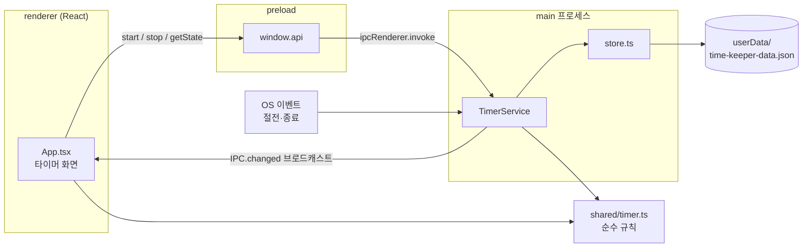

# 아키텍처

## 개요
Electron 데스크톱 앱이다. main 프로세스의 `TimerService`가 타이머 상태를 단독으로 소유하고 로컬 JSON 파일에 저장한다.
렌더러(React 화면)는 preload가 노출한 `window.api`로 시작·종료를 요청하고, 상태가 바뀔 때마다 브로드캐스트를 받아 다시 그린다.
타이머 규칙(전환·마감·집계)은 `src/shared/timer.ts`의 순수 함수로, main과 renderer가 같은 코드를 쓴다.

## 구조도

## 컴포넌트
- **타이머 규칙** — 분야 전환 시 자동 마감, 종료, 비정상 종료 복구, 구간 집계, 시:분:초 포맷 — `src/shared/timer.ts`
- **IPC 채널** — main·preload가 공유하는 채널 이름 — `src/shared/ipc.ts`
- **TimerService** — 상태 소유, IPC 핸들러, 30초 heartbeat, 절전 시 마감, 종료 시 마감 — `src/main/timerService.ts`
- **store** — 로컬 JSON 읽기/원자적 쓰기, 기기 ID 발급 — `src/main/store.ts`
- **앱 수명 관리** — 단일 인스턴스, X 버튼 = 숨기기, 종료 확인(`requestQuit`), OS 종료·로그오프 시 마감 — `src/main/index.ts`
- **트레이** — 열기/종료 메뉴, 툴팁에 현재 분야·경과 시간(1초 갱신) — `src/main/tray.ts`
- **문구** — 분야 이름·화면·트레이·대화상자 문구, 상태 요약(`statusText`) — `src/shared/labels.ts`
- **preload API** — `getState`/`start`/`stop`/`onChanged` — `src/preload/index.ts`, 타입 `index.d.ts`
- **타이머 화면** — 현재 분야·경과 시간, 시작 버튼 3개·종료, 오늘 합계 — `src/renderer/src/App.tsx`

## 데이터 흐름
1. 사용자가 "쉼 시작"을 누르면 `window.api.start('break')` → IPC `timer:start`.
2. `TimerService`가 `timer.start()`로 진행 중이던 기록을 그 시각으로 마감하고 새 기록을 연 뒤 `store.save()`로 파일에 쓴다.
3. 모든 창에 `timer:changed`로 새 상태를 보내고, 화면은 `now - startedAt`과 `totalsBetween()`으로 표시한다.
4. 다음 실행 때 파일에 `active`가 남아 있으면(비정상 종료) `timer.recover()`가 마지막 heartbeat 시각으로 마감한다.

## 외부 의존 · 인프라
- 로컬 파일 `userData/time-keeper-data.json` — 기록 저장 (Windows: `%APPDATA%\time-keeper\`)
- GitHub Actions + Releases — 설치 파일 빌드·배포 (`.github/workflows/time-keeper-release.yml`, 루트)
- (예정) 사용자 본인의 Google Drive — 기기별 파일 동기화, #7

## 주요 결정 · 제약
- **데스크톱 앱 (Electron + React)** — 서버 없이 앱만 나눠 주고 각자 쓰는 것이 목적(사용자 결정). 화면은 레포 표준 React+Vite+TS를 유지하고 창 껍데기만 Electron. 레포 규칙의 데스크톱 예외(#1).
- **상태는 main이 단독 소유** — 기본·미니 창이 동시에 떠도(#5) 상태가 하나여야 하고, 종료·절전 이벤트는 main에서만 받을 수 있다.
- **로컬 우선 저장** — 오프라인·비로그인에서도 동작해야 한다(사용자 결정). 동기화는 로컬 파일을 올리는 부가 기능이다.
- **앱 종료·절전 시 기록 자동 마감** (사용자 결정) — 비정상 종료는 30초 heartbeat로 오차를 제한한다.
- **X 버튼은 트레이로 숨기기, 종료는 트레이에서 확인 후** (사용자 결정) — 실수로 기록이 끊기지 않게 한다. mac Cmd+Q·Dock 종료도 `before-quit`에서 같은 확인을 거친다. OS 종료·로그오프(Windows `session-end`, mac `powerMonitor.shutdown`)는 확인 없이 마감한다.
- **단일 인스턴스** — 두 프로세스가 같은 기록 파일을 덮어쓰지 않도록, 두 번째 실행은 기존 창을 띄우고 끝난다.
- **기기별 파일 동기화** — 각 기기가 자기 파일에만 쓰므로 여러 기기 동시 사용에도 쓰기 충돌이 없다.
- **OAuth 키는 사용자가 직접 입력** (사용자 결정) — 공개 레포라 키를 빌드에 넣지 않는다. 대신 사용자 설정이 번거롭다.
- **코드 서명 없음** — 비용 때문. Windows SmartScreen·mac Gatekeeper 경고를 README로 안내하고, mac 자동 업데이트가 불가하므로 새 버전은 알림만 한다(#9).
- **macOS는 universal dmg** — Apple Silicon·Intel 모두 하나의 파일로 지원. Mac 빌드는 GitHub Actions의 macOS 러너에서만 한다.
