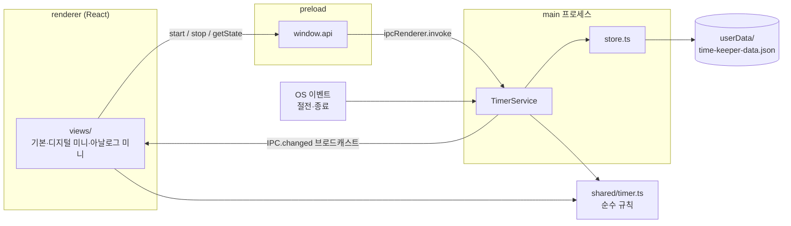

# 아키텍처

## 개요
Electron 데스크톱 앱이다. main 프로세스의 `TimerService`가 타이머 상태를 단독으로 소유하고 로컬 JSON 파일에 저장한다.
렌더러(React 화면)는 preload가 노출한 `window.api`로 시작·종료를 요청하고, 상태가 바뀔 때마다 브로드캐스트를 받아 다시 그린다.
타이머 규칙(전환·마감·집계)은 `src/shared/timer.ts`의 순수 함수로, main과 renderer가 같은 코드를 쓴다.

## 구조도

## 컴포넌트
- **타이머 규칙** — 분야 전환 시 자동 마감, 종료, 비정상 종료 복구, 구간 집계, 시:분:초 포맷, 준비 선택 규칙(`select`/`canStart`) — `src/shared/timer.ts`
- **IPC 채널** — main·preload가 공유하는 채널 이름 — `src/shared/ipc.ts`
- **TimerService** — 상태 소유, IPC 핸들러, 30초 heartbeat, 절전 시 마감, 종료 시 마감 — `src/main/timerService.ts`
- **store** — 로컬 JSON 읽기/원자적 쓰기, 기기 ID 발급 — `src/main/store.ts`
- **앱 수명 관리** — 단일 인스턴스, 종료 확인(`requestQuit`), OS 종료 시 마감 — `src/main/index.ts`
- **창 관리** — 기본/디지털 미니/아날로그 미니 창을 하나씩 만들어 두고 하나만 표시(`openView`), X = 숨기기, 항상 위, 미니 드래그, 내용에 맞춘 창 높이(`window:fitHeight`) — `src/main/windows.ts`
- **트레이** — 열기/종료 메뉴, 툴팁에 현재 분야·경과 시간(1초 갱신) — `src/main/tray.ts`
- **통계 계산** — 기간(오늘/주/월/직접) 범위, 일별 합계, 비율 — `src/shared/stats.ts`
- **통계 화면** — 기간 탭, 비율 막대 + 합계 표, 일별 누적 막대(호버 툴팁) — `src/renderer/src/views/StatsView.tsx`, `components/DailyChart.tsx`
- **구글 드라이브 동기화** — OAuth(루프백+PKCE)·토큰 갱신·드라이브 REST·동기화 한 바퀴는 Electron 없는 모듈(`src/main/sync/oauth·session·drive·syncEngine.ts`), 키 암호화 저장·브라우저·주기 실행·IPC 는 `src/main/sync/syncService.ts`, 화면은 `views/SyncPanel.tsx`
- **설정** — 기기별 설정 저장·검증·모든 창에 방송 — `src/main/settingsService.ts`, 형식 `src/shared/settings.ts`, 화면 `views/SettingsView.tsx`
- **본체 색** — 고른 색에서 테두리·그림자·글자색 계산(어떤 색이든 글자 대비 4.5:1) — `src/shared/theme.ts`
- **문구 (한/영)** — 언어별 문구 묶음(`ko`·`en`), 언어 결정(`resolveLocale`), 상태 요약(`statusText`·`headline`) — `src/shared/labels.ts`. 렌더러는 `MessagesContext`/`useT()`(`src/renderer/src/i18n.ts`)로 받는다
- **preload API** — `getState`/`start`/`stop`/`onChanged` — `src/preload/index.ts`, 타입 `index.d.ts`
- **화면** — `App.tsx`가 URL 해시(#main/#digital/#analog)로 `views/`의 화면을 고른다. LCD·키는 `components/`를 세 화면이 함께 쓴다. 준비 선택값은 창마다의 로컬 상태이고, 진행 기록이 바뀌면 저절로 풀린다(`hooks.ts > useSelection`)

## 데이터 흐름
1. 사용자가 [쉼]으로 준비한 뒤 [시작]을 누르면 `window.api.start('break')` → IPC `timer:start`. (준비 단계는 화면 안에서만 일어나고 main 은 모른다.)
2. `TimerService`가 `timer.start()`로 진행 중이던 기록을 그 시각으로 마감하고 새 기록을 연 뒤 `store.save()`로 파일에 쓴다.
3. 모든 창에 `timer:changed`로 새 상태를 보내고, 화면은 `now - startedAt`과 `totalsBetween()`으로 표시한다.
4. 다음 실행 때 파일에 `active`가 남아 있으면(비정상 종료) `timer.recover()`가 마지막 heartbeat 시각으로 마감한다.

## 외부 의존 · 인프라
- 로컬 파일 `userData/time-keeper-data.json` — 기록 저장 (Windows: `%APPDATA%\time-keeper\`)
- GitHub Actions + Releases — 설치 파일 빌드·배포 (`.github/workflows/time-keeper-release.yml`, 루트)
- 사용자 본인의 Google Drive — `Jjadalsiri Timer` 폴더에 기기별 `sessions-<기기ID>.json` (#7). 권한 `drive.file`. OAuth 클라이언트는 사용자가 직접 만든다(`docs/google-drive-setup.md`)

## 주요 결정 · 제약
- **동기화는 기기별 파일 + 읽기 전용 병합** (#7) — 기기마다 자기 파일에만 쓰므로 여러 기기가 동시에 동기화해도 덮어쓰지 않는다. 다른 기기 기록은 통계에만 더해지고 이 기기 파일에는 들어가지 않는다. 마지막으로 받은 기록·동기화 시각은 `userData/remote-sessions.json`에 남겨 오프라인·재시작에서도 보인다.
- **OAuth 는 서버 없는 데스크톱 방식** — 루프백(`127.0.0.1:임의포트`) 리디렉트 + PKCE(S256). 구글이 데스크톱 앱에 권장하는 방식이다. 키는 사용자가 만든 것이라 레포·설치본에 비밀이 없다. 리프레시 토큰은 `safeStorage`(Windows DPAPI / macOS 키체인)로 암호화한다.
- **동기화 핵심은 Electron 과 분리** — 실제 구글 키 없이도 동기화 전체를 검증하려고, 엔진은 주소를 바꿔 끼울 수 있게 만들고 가짜 구글 서버로 테스트한다.
- **언어는 main 이 정한다** (#8) — 설정이 "시스템 언어"면 OS 선호 언어(`app.getPreferredSystemLanguages`)가 한국어일 때 한국어, 아니면 영어. 트레이·대화상자도 같은 언어여야 해서 결정을 main(`SettingsService`)에 두고, 렌더러는 결과(`resolvedLocale`)만 받는다.
- **설정은 기기별 파일, 기록과 분리** — 본체 색·성적표 접힘 같은 화면 취향은 기기마다 달라도 되고 잃어도 되는 값이다. 동기화 대상인 기록 파일(#7)에 섞지 않는다.
- **본체 색만 사용자 지정** (사용자 결정) — LCD·분야 키 색은 그대로 둬서 어떤 색을 골라도 숫자와 분야가 읽힌다. 글자색은 고른 색에 맞춰 계산하고, RGB 4096가지 표본에서 대비 4.5:1 이상을 테스트로 보장한다.
- **저장은 UTC 기준 절대 시각, 날짜는 보는 곳의 시간대로** (사용자 확인) — 기록의 시작·끝은 epoch ms(1970-01-01 00:00 UTC부터의 밀리초)로만 저장해 기기·시간대와 무관하다. "오늘", "이번 주", 일별 막대처럼 날짜로 나누는 일은 화면에 보여줄 때 그 기기의 현지 시간대로 한다. 날짜 이동은 달력 단위(`setDate`/`setMonth`)라 윤년·월 길이·서머타임은 OS 시간대 데이터가 처리한다. 여러 시간대 테스트: `src/shared/calendar.test.ts`.
- **데스크톱 앱 (Electron + React)** — 서버 없이 앱만 나눠 주고 각자 쓰는 것이 목적(사용자 결정). 화면은 레포 표준 React+Vite+TS를 유지하고 창 껍데기만 Electron. 레포 규칙의 데스크톱 예외(#1).
- **상태는 main이 단독 소유** — 기본·미니 창이 동시에 떠도(#5) 상태가 하나여야 하고, 종료·절전 이벤트는 main에서만 받을 수 있다.
- **로컬 우선 저장** — 오프라인·비로그인에서도 동작해야 한다(사용자 결정). 동기화는 로컬 파일을 올리는 부가 기능이다.
- **앱 종료·절전 시 기록 자동 마감** (사용자 결정) — 비정상 종료는 30초 heartbeat로 오차를 제한한다.
- **X 버튼은 트레이로 숨기기, 종료는 트레이에서 확인 후** (사용자 결정) — 실수로 기록이 끊기지 않게 한다. mac Cmd+Q·Dock 종료도 `before-quit`에서 같은 확인을 거친다. OS 종료·로그오프(Windows `session-end`, mac `powerMonitor.shutdown`)는 확인 없이 마감한다.
- **창은 여러 개, 보이는 건 하나** — 미니 창을 별도 BrowserWindow로 두면 크기·투명도·항상 위를 창마다 다르게 줄 수 있다. 상태는 main이 하나로 갖고 있어 어느 창에서 눌러도 모든 창이 같이 바뀐다.
- **미니 창 드래그를 직접 구현** — CSS drag 영역은 Windows에서 더블클릭 이벤트를 삼켜 "더블클릭 → 기본 모드"가 안 된다. 렌더러가 mousedown/up을 알리면 main이 커서를 따라 창을 옮긴다.
- **단일 인스턴스** — 두 프로세스가 같은 기록 파일을 덮어쓰지 않도록, 두 번째 실행은 기존 창을 띄우고 끝난다.
- **기기별 파일 동기화** — 각 기기가 자기 파일에만 쓰므로 여러 기기 동시 사용에도 쓰기 충돌이 없다.
- **OAuth 키는 사용자가 직접 입력** (사용자 결정) — 공개 레포라 키를 빌드에 넣지 않는다. 대신 사용자 설정이 번거롭다.
- **코드 서명 없음** — 비용 때문. Windows SmartScreen·mac Gatekeeper 경고를 README로 안내하고, mac 자동 업데이트가 불가하므로 새 버전은 알림만 한다(#9).
- **macOS는 universal dmg** — Apple Silicon·Intel 모두 하나의 파일로 지원. Mac 빌드는 GitHub Actions의 macOS 러너에서만 한다.
