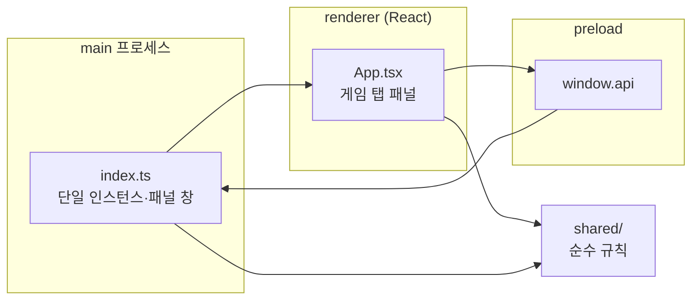

# 아키텍처

## 개요
Electron 데스크톱 앱이다. main 프로세스가 패널 창 하나를 소유하고, 숨겨진 동안에는 창을 실제로 숨긴 채 커서 위치로 화면 모서리(핫존)를 감지한다 (#33).
렌더러(React 화면)는 패널 안의 체스·스도쿠를 그린다. 게임 규칙·스도쿠 생성·핫존 계산은 `src/shared/`의 순수 함수로 두어 Electron 없이 테스트한다.

## 구조도

## 컴포넌트
- **앱 수명** — 단일 인스턴스(두 번째 실행은 첫 인스턴스의 창을 띄우고 끝남), 패널 창 생성 — `src/main/index.ts`
- **패널 화면** — 체스/스도쿠 탭과 게임 자리 — `src/renderer/src/App.tsx`
- **디자인 토큰** — 중성색, OS 다크/라이트 — `src/renderer/src/assets/main.css`

이후 이슈에서 추가될 것: 핫존 감지·패널 표시/숨김(#33), 스도쿠(#34), 체스(#35), 설정·트레이(#36), 한/영 문구(#37).

## 주요 결정
- **Electron 데스크톱 앱** — 업무 화면 위 어디서나 떠야 해서 OS 창이 필요하다. 웹·브라우저 확장은 버렸다 (`docs/design.md > 형태·배포`).
- **숨긴 동안 창을 숨기고 커서를 폴링** — 투명 클릭 통과 창은 흔적이 남고 OS별로 호버 감지가 불안정하다.
- **서명 없음** — 첫 실행 경고 우회는 `README.md`에 안내한다. 릴리스 워크플로는 인증서 자동 탐색을 끈다.
- **GPL 의존성 금지** — 레포에 LICENSE가 없어 설치 파일에 GPL 코드를 넣지 않는다. 체스 엔진은 MIT 계열.
