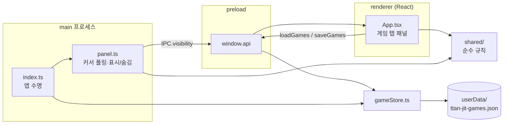

# 아키텍처

## 개요
Electron 데스크톱 앱이다. main 프로세스가 패널 창 하나를 소유하고, 숨겨진 동안에는 창을 실제로 숨긴 채 커서 위치로 화면 모서리(핫존)를 감지한다 (#33).
렌더러(React 화면)는 패널 안의 체스·스도쿠를 그린다. 게임 규칙·스도쿠 생성·핫존 계산은 `src/shared/`의 순수 함수로 두어 Electron 없이 테스트한다.

## 구조도

## 컴포넌트
- **앱 수명** — 단일 인스턴스, mac Dock 숨김 — `src/main/index.ts`
- **패널** — 창 하나를 만들어 두고 숨김/표시만 한다. 커서를 폴링(숨김 중 50ms, 표시 중 ≈16ms)해 `nextPanelState`로 판정, 띄울 때마다 주 모니터 모서리에 다시 붙이고 `showInactive`. 작업표시줄·Alt+Tab 숨김(Windows `toolbar`, mac `panel`), `screen-saver` 층 항상 위, 화면 캡처 제외 — `src/main/panel.ts`
- **핫존 규칙** — 모서리 사각형·패널 위치·표시/숨김 상태 전이(순수 함수) — `src/shared/hotzone.ts`
- **스도쿠 규칙** — 비트마스크 백트래킹 풀이·해 개수, 무작위 완성 판에서 유일해를 지키며 지우는 생성, 싱글만으로 풀리는지 판정(쉬움·보통은 싱글로 풀림, 어려움은 안 풀림) — `src/shared/sudoku.ts`
- **스도쿠 한 판** — 숫자·메모·지우기·되돌리기(최대 100)·풀이 시간·저장 검사, 모두 새 객체를 돌려주는 순수 함수 — `src/shared/sudokuGame.ts`, 화면 `src/renderer/src/views/SudokuView.tsx`
- **게임 저장** — 렌더러가 상태를 갖고 바뀔 때마다 `saveGames`, main 이 1초 모아 `userData/ttan-jit-games.json`에 원자적으로 쓰고 종료 시 flush. 읽을 때 `normalizeGames`로 검사(깨지면 새 판) — `src/main/gameStore.ts`, `src/shared/games.ts`
- **보임 신호** — main → renderer `IPC.visibility`, 렌더러 `usePanelVisible()` — `src/shared/ipc.ts`, `src/preload/index.ts`, `src/renderer/src/hooks.ts`
- **패널 화면** — 체스/스도쿠 탭과 게임 자리 — `src/renderer/src/App.tsx`
- **디자인 토큰** — 중성색, OS 다크/라이트 — `src/renderer/src/assets/main.css`

이후 이슈에서 추가될 것: 체스(#35), 설정·트레이(#36), 한/영 문구(#37).

## 주요 결정
- **Electron 데스크톱 앱** — 업무 화면 위 어디서나 떠야 해서 OS 창이 필요하다. 웹·브라우저 확장은 버렸다 (`docs/design.md > 형태·배포`).
- **숨긴 동안 창을 숨기고 커서를 폴링** — 투명 클릭 통과 창은 흔적이 남고 OS별로 호버 감지가 불안정하다.
- **서명 없음** — 첫 실행 경고 우회는 `README.md`에 안내한다. 릴리스 워크플로는 인증서 자동 탐색을 끈다.
- **GPL 의존성 금지** — 레포에 LICENSE가 없어 설치 파일에 GPL 코드를 넣지 않는다. 체스 엔진은 MIT 계열.
